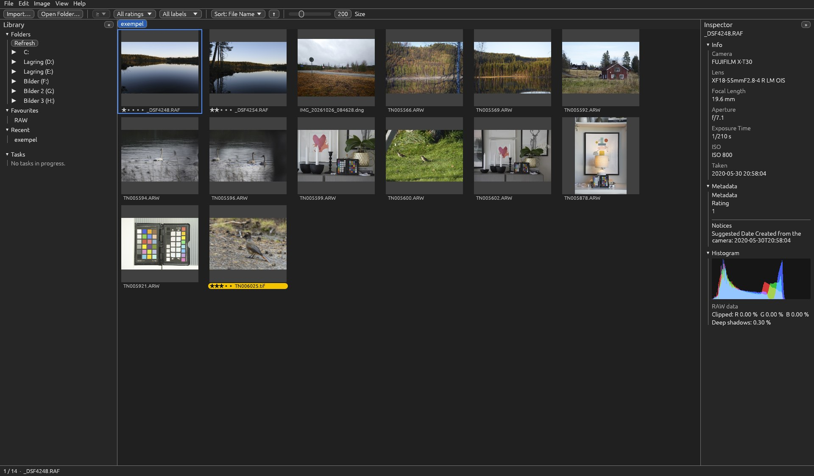
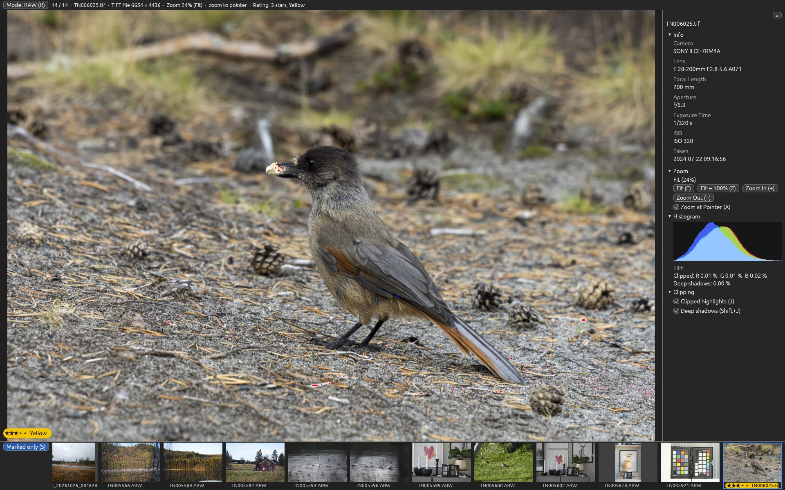
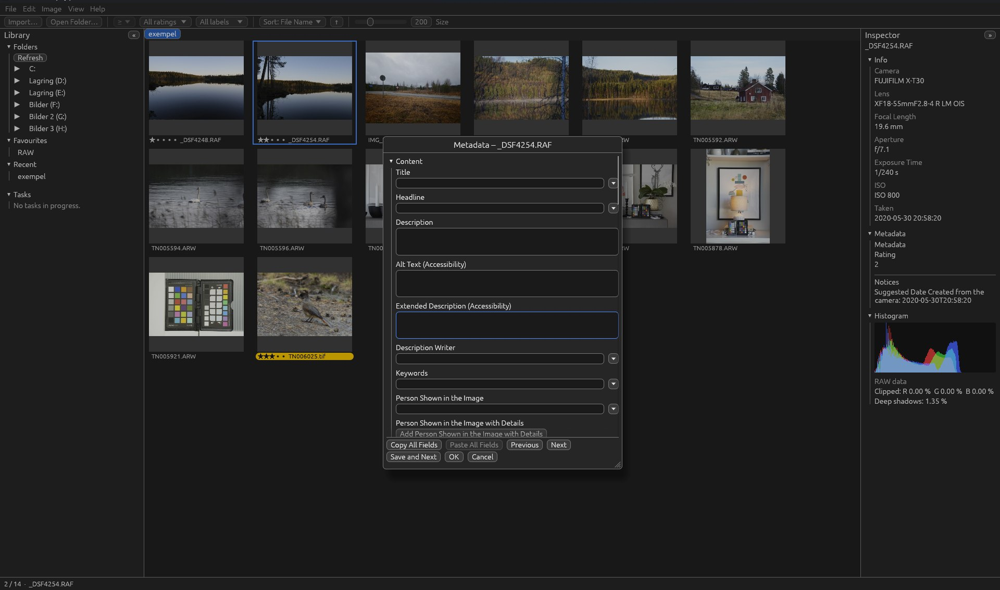

# RawStride

A fast and lightweight photo culling and ingest program for Windows: copy the photos off the card,
step through them quickly, rate and label them, and add IPTC metadata.

> **Status: in development; latest pre-release `0.3.0` (2026-11-22), a portable zip for Windows on
> the [Releases page](https://github.com/Bokehlicious/RawStride/releases).** The program
> (`rawstride.exe`, built from the crate `pw-loupe`; eframe + egui) has the loupe and preview, the
> contact sheet, folder tabs, the import dialog, ratings and labels, filter and multi-selection, TIFF
> viewing, colour management and the metadata window. See [Planned](#planned) for what is not
> there yet.

The project was called PhotoWorkflow until 2026-11-09 ([ADR 0012](docs/adr/0012-product-name-rawstride.md)).
Folder and crate names (`pw-*`) keep the old name for now.



## What it does

- **Import:** copies from a memory card to a destination and an optional backup, with folder and
  file name templates, and can write a metadata template into the copies and eject the card.
- **Culling:** a contact sheet and a loupe built for speed: RAW files are shown from their embedded
  preview or rendered with LibRaw, and the next image is prepared ahead.
- **Ratings and labels:** stars, reject and colour labels in XMP (`xmp:Rating`, `xmp:Label`), read
  and written the way other photo programs do.
- **Metadata:** IPTC Core and Extension in XMP, and the older IIM, following the IPTC standards. A
  proprietary RAW file is never modified: its metadata goes into an XMP sidecar. DNG, JPEG and TIFF
  get the metadata inside the file, written safely (a backup and a check after every write).
- **Metadata templates:** fill in and save templates as XMP files, load and save them from the
  metadata window, and apply them to the marked images from the right-click menu or to every
  image of an import; text fields can hold variables such as `{date}` and `{name}`.
- **Settings:** choose which sections and fields the metadata window shows and in which order,
  and change the keyboard shortcuts.

| Loupe | Metadata window |
| --- | --- |
|  |  |

**Cameras:** the goal is most cameras, through LibRaw. Development and testing use Sony (ARW),
Panasonic (RW2), Fujifilm (RAF) and DNG files.

## Planned

Not in RawStride yet, roughly in the order they are planned. The order can change, and there
are no dates.

- **Search and filter on text and metadata:** a search box (Ctrl+F), a filter window and saved
  filters.
- **All camera data:** every Exif and maker tag in the inspector.
- **Correcting the capture time:** shift the capture time for one camera or several, for example
  when a camera's clock was wrong.
- **Rename, copy and move** selected images, with their sidecars.
- **Export:** JPEG and TIFF at a chosen size, with colour conversion and metadata.
- **Display adjustments for assessment:** temporary exposure, white balance, sharpening, channel
  view, clipping thresholds, the camera's crop frame and focus point. Nothing is written to the
  file.
- **Editor profiles:** see which images have been edited in another program, and step between an
  original and its export.
- **A catalog across folders:** search all indexed images, including folders on drives that are
  not connected.
- **Positions and a map:** edit GPS coordinates, see images on a map, and match a GPX track to
  capture times.
- **Signed releases and an installer (MSI).**

Ideas and wishes are welcome as [issues](https://github.com/Bokehlicious/RawStride/issues/new/choose).

## Try it

Testers are welcome, especially with cameras and file types other than the ones above.

1. Download `RawStride-<version>-windows-x64.zip` from the
   [Releases page](https://github.com/Bokehlicious/RawStride/releases) (Windows 10 or 11, x64;
   nothing else to install, ExifTool is included).
2. Unpack it anywhere and start `rawstride.exe`. The program is not signed yet, so Windows
   SmartScreen warns the first time: choose "More info", then "Run anyway".
3. **Try it on copies of your photos first.** RawStride writes ratings, labels and metadata (into
   XMP sidecars for RAW files, into DNG, JPEG and TIFF files themselves), and this is a first
   pre-release.

Found a bug, or a file that does not open? [Open an issue](https://github.com/Bokehlicious/RawStride/issues/new/choose);
the form asks for what helps. Ideas are welcome the same way. To remove RawStride, delete its
folder and `%LOCALAPPDATA%\RawStride`.

## Building

Windows 10 or 11, x64. RawStride runs only on Windows today; if you would like it on Linux or
macOS, open an issue to say so. See [docs/building.md](docs/building.md): Visual Studio Build Tools, Rust,
vcpkg and ExifTool, then

```powershell
vcpkg install --triplet x64-windows-static-md
cargo run --release -p pw-loupe
```

The tests that read real camera files need the maintainer's test files and are skipped without
them, also in CI: a green CI run does not mean a RAW file was decoded or written
([docs/TESTING.md](docs/TESTING.md) §11).

## Contributing

See [CONTRIBUTING.md](CONTRIBUTING.md). Open an issue before a larger change. Test reports are
contributions too: a bug report with the camera and file type helps as much as code.

## How RawStride is developed

RawStride is written with AI coding agents, directed and reviewed by its maintainer.

- **The maintainer decides.** Requirements, architecture and every design decision are the
  maintainer's, recorded with their reasons in the [ADRs](docs/adr/) and
  [requirements](docs/GUI_REQUIREMENTS.md).
- **Agents do small, written tasks.** Each change starts as a task file under
  [`docs/tasks/`](docs/tasks/README.md) that states what to change, which files, and which tests
  to add. An agent carries out one task and leaves its change uncommitted.
- **Nothing goes in unreviewed.** Every change is reviewed against its task and must pass
  `tools/check.ps1` (formatting, personal data, `cargo audit`, all tests, clippy without warnings) before the
  maintainer approves it. Changes that affect what the user sees or what is written to files are
  also checked by hand in the running program.
- **The same rules bind people and agents.** [`AGENTS.md`](AGENTS.md) holds the rules every agent
  follows: no panics in non-test code, no new dependencies without approval, no weakened tests,
  and the [clean-room policy](docs/clean-room.md).

The task files are kept as part of the project's history: [`docs/tasks/done/`](docs/tasks/done/)
shows how each feature was specified and built. You do not need to read them to contribute; the
ADRs and [CONTRIBUTING.md](CONTRIBUTING.md) are the place to start. Contributions written with or
without AI tools are welcome under the same review.

## Layout

```
crates/        Rust libraries and the RawStride program (crate pw-loupe, rawstride.exe)
docs/          Architecture, requirements, ADRs, building, testing
third_party/   Notes, pins and licences for native dependencies
tools/         Developer scripts and benchmarks
tests/fixtures Small, licence-clean test files only
```

## Stack

| Area | Choice |
|---|---|
| Program | Rust, eframe + egui (renderer glow) |
| RAW decoding | LibRaw (vcpkg, static), plus a fast path for the embedded preview |
| JPEG decoding | libjpeg-turbo (vcpkg, static) |
| Metadata | ExifTool (one persistent `-stay_open` process) |

## Licence

RawStride is licensed under the GNU General Public License, version 3 or later
([LICENSE](LICENSE), [ADR 0002](docs/adr/0002-licensing.md)). LibRaw is used under the LGPL-2.1;
ExifTool is a separate program, used unmodified.

## Clean room

RawStride is developed under a [clean-room policy](docs/clean-room.md). No code, assets or
decompiled material from other products may enter this repository. Product names mentioned in the
repository are trademarks of their respective owners; RawStride is not affiliated with them.
