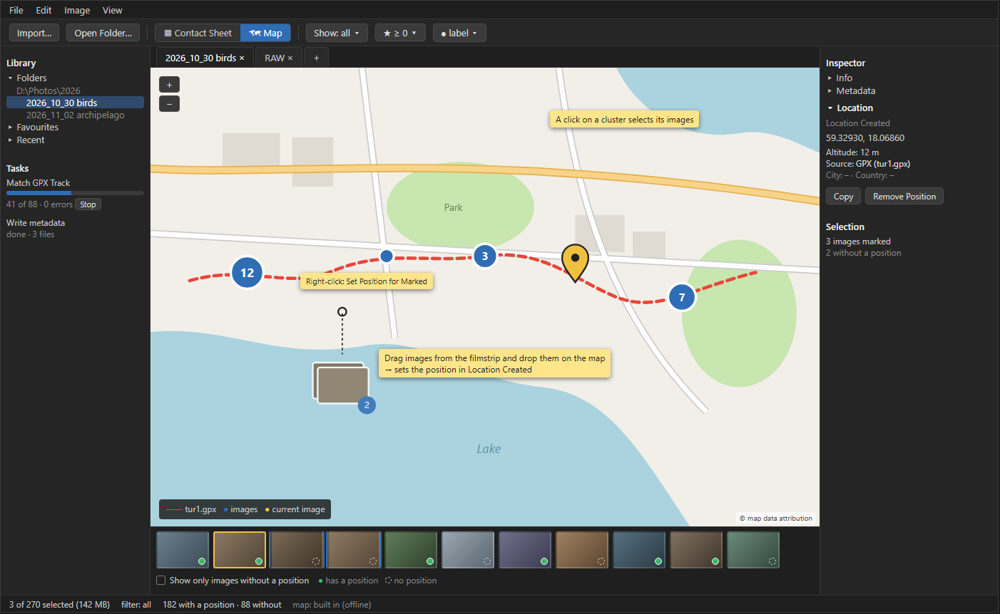
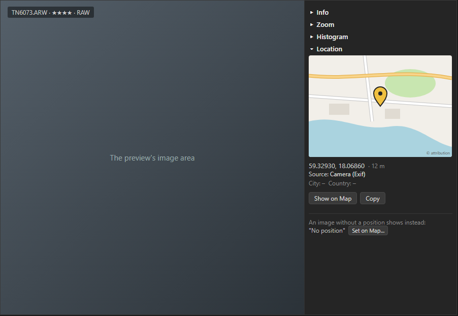
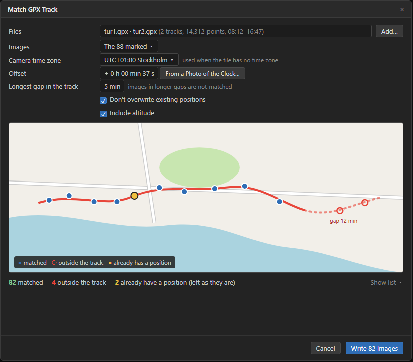

# ADR 0028: Positions, a map and GPX tracks

- Status: **proposed, parked (owner, 2026-11-19).** A draft written down so the thinking is
  kept; many steps come before it. No question in §4 is answered, nothing is placed in the step
  plan, and nothing is built, installed or added as a dependency by this ADR. When it is taken
  up, the questions are answered first and each step in §5 becomes its own task, with its own
  approval and commit.
- Date: 2026-11-19
- Related:
  - ADR 0017 §7.2 (the row "GPS: import a GPX track …, set a position on a map, fill in city,
    country and location from the position"), which this ADR takes up; §2.1 (main window,
    inspector), §2.2 (preview's right column), §2.3.1 (GPS coordinates read-only "until the GPS
    ADR"), U7b-Q8 (an overlay's texture kept outside the view's texture budget);
  - ADR 0007 §6.3 ("Exif → IPTC only", Exif never written), §6.7 (camera GPS fills the
    coordinates of Location Created; reverse geocoding, a GPX track and a map left to this ADR),
    §7 (date, time and time zone), §8 (one location in the window), §9.5 (batches);
  - ADR 0020 (correcting the capture time): GPX matching uses the corrected time (its C-Q12);
  - ADR 0022 §2.4 (reading values per folder, only when needed, kept per tab): positions are read
    the same way (§2.7);
  - ADR 0025 (export): whether a position can be left out of an exported image (L-Q5);
  - ADR 0009 §6.1 and `docs/GUI_REQUIREMENTS.md` §6 (egui pinned to exactly 0.37.0): why the map
    component is proposed as RawStride's own (§2.6);
  - ADR 0002 (licence `GPL-3.0-or-later`): every new dependency and every map data source;
  - [clean-room.md](../clean-room.md): the functions are described in our own words, from
    RawStride's own needs.

## 1. Context

What exists today (code and ADRs read 2026-11-19):

- `pw-metadata` reads the six Exif GPS tags and fills the coordinates of Location Created when it
  has none (T196, ADR 0007 §6.7). Only the first entry of Location Created is looked at.
- The coordinates are shown, but read-only in the metadata window (ADR 0017 §2.3.1). There is no
  way to set, change or remove a position.
- RawStride uses no network at all. Nothing in it fetches or sends anything.
- There is no map, and no way to see where a set of images was taken.

The owner wants to:

1. see on a map where the images of a folder were taken;
2. set a position for one or more images directly on a map;
3. set positions from a GPX track recorded during the shoot, matched against the capture times.

## 2. Decision (proposed)

### 2.1 Offline by default

Most of the function needs no network:

- reading the camera's GPS, showing and editing coordinates, copying a position between images;
- reading a GPX file and matching it against capture times (a local file and plain computation);
- drawing a GPX track and the images' positions.

Only a **detailed map background** may need network. The proposal (§2.5, L-Q2) is that RawStride
stays without network unless the user turns it on: the default background is built in, and online
map tiles are an explicit choice in Settings.

### 2.2 Where it sits in the interface

Two levels, so viewing stays light and editing has room:

1. **A Location section** in the inspector (ADR 0017 §2.1) and in the preview's right column
   (§2.2), collapsible and remembered like the other sections: a small map with a pin, the
   coordinates, the altitude, where the position came from (camera, GPX, set by hand) and the
   buttons Show on Map and Copy. An image without a position shows "No position" and Set on Map….
   It follows the current image with the inspector's rules (200 ms wait, old answers discarded).
2. **A Map view** in the main area, as an alternative to the contact sheet. It belongs to the
   folder tab: the same folder, filter and selection. A switch Contact Sheet | Map in the command
   bar (ADR 0017 §2.1) and a key (L-Q13) change between them.
   - The map shows the tab's shown images (after the filter, ADR 0014) as pins, grouped into
     numbered clusters where they lie close together.
   - Selection follows both ways: a click on a pin or a cluster selects its images; selecting in
     the filmstrip highlights them on the map. The current image is its own colour.
   - A filmstrip under the map shows the same images, each marked as with or without a position,
     with a check box "Show only images without a position".
   - A loaded GPX track is drawn as a line.
   - The status line gains "{n} with a position · {m} without".

The GPX matching is a dialog in the Edit menu, beside Metadata… (§2.4; the menu and key are
decided in L7); its writing runs as a task in Tasks (ADR 0017 §2.1), with progress, stop and a
list of errors.

```
┌ Menu bar ───────────────────────────────────────────────────────────────────────────────────┐
│ Command bar: Import · Open Folder · [Contact Sheet | Map] · filter · stars                  │
├──────────────┬────────────────────────────────────────────────────────────┬─────────────────┤
│ Library      │ [2026_10_30 birds ×] [RAW ×] [+]                           │ Inspector       │
│ ▾ Folders    │ ┌────────────────────────────────────────────────────────┐ │ ▸ Info          │
│              │ │        ~~~~ lake ~~~~          (3)                     │ │ ▸ Metadata      │
│ ▾ Tasks      │ │   (12)          ·····GPX track·····                    │ │ ▾ Location      │
│  Match GPX   │ │        ⬤ ◉ (current)  ·····           (7)              │ │  59.3293,       │
│  ███░░ 41/88 │ │  [+][−]                              © attribution     │ │  18.0686 · 12 m │
│              │ └────────────────────────────────────────────────────────┘ │  Source: GPX    │
│              │ Filmstrip: [▣][▣][▢][▢][▣][▢]…   ▢ = no position           │                 │
│              │ ☐ Show only images without a position                      │                 │
├──────────────┴────────────────────────────────────────────────────────────┴─────────────────┤
│ Status: 3 of 270 selected · 182 with a position · 88 without                                │
└─────────────────────────────────────────────────────────────────────────────────────────────┘
```

All texts in this ADR are proposals; the final ones follow GR14 and the glossary in each step.

Sketches (illustrations made for this draft, 2026-11-19, not screenshots of RawStride; the map
background is invented and drawn at street level, which source A in §2.5 does not give):





### 2.3 Setting a position

- **In the metadata window:** the coordinates and the altitude of Location Created become
  editable (lifting ADR 0017 §2.3.1's "read-only until the GPS ADR"), with the window's usual
  rules: Apply to All Marked, copy and paste all fields, the Save / Discard / Cancel question.
  The accepted input forms (decimal degrees, degrees-minutes-seconds, a pasted "lat, lon") are
  decided in the step.
- **On the map:** images dragged from the filmstrip and dropped on the map, or "Set Position for
  Marked" from the map's context menu, get that point.
- **Remove Position** in the Location section and the context menu.
- **Writing** goes through ADR 0007's write path unchanged: XMP in JPEG, TIFF and DNG, the sidecar
  for a manufacturer RAW file, which is never changed. Which properties receive the position is
  L-Q1. Several images are a batch under §9.5, with one confirmation that names the count.
- An image that already has another position is not changed silently: the confirmation names how
  many have one and offers to leave them (L-Q3).

### 2.4 Matching a GPX track

- **Input:** one or more GPX files (tracks; whether routes and waypoints count is decided in the
  step), and the images (the selected, or the tab's shown).
- **Time:** GPX times are UTC. An image's capture time is taken as ADR 0020 has corrected it, with
  the time zone from the file (ADR 0007 §7) or, when the file has none, the zone chosen in the
  dialog. A time offset (h, min, s) adjusts for a camera clock that was wrong.
- **Matching:** an image between two track points gets a position interpolated linearly in time
  between them; an image within a gap longer than "Longest gap in the track" (proposed default
  5 min), or outside the track, is not matched.
- **Preview:** before anything is written the dialog draws the track and the matched images on a
  map, and counts matched, outside the track and already with a position.
- **Default:** "Don't overwrite existing positions" on, so the camera's GPS and positions set by
  hand are kept (L-Q3). Altitude included or not (L-Q12).
- **Writing:** a task in Tasks, each file its own write (§9.5), with stop and an error list.
- A possible help (L-Q14): "From a photo of the clock…", which works out the offset from an image
  of the GPS device's clock and the time read off it.

```
┌ Match GPX Track ─────────────────────────────────────────────┐
│ Files:     tur1.gpx, tur2.gpx (2 tracks, 08:12–16:47) [Add…] │
│ Images:    The 88 marked ▾                                   │
│ Camera time zone: [UTC+01:00 ▾]   Offset: [+0 h 00 min 37 s] │
│ Longest gap in the track: [5 min]                            │
│ ☑ Don't overwrite existing positions   ☑ Include altitude    │
│ ┌ map: the track and the matched images ───────────────────┐ │
│ └──────────────────────────────────────────────────────────┘ │
│ 82 matched · 4 outside the track · 2 already have a position │
│                                  [Cancel]  [Write 82 Images] │
└──────────────────────────────────────────────────────────────┘
```



### 2.5 The map background: three sources

The map component draws the same view from any of three sources; the source is a setting.

| Source | What | Network | Detail | Cost [estimate, 2026-11-19] |
|---|---|---|---|---|
| **A. Built in** | Coastlines, lakes, borders and larger places from Natural Earth (public domain), drawn as vectors | None | Region to town; not street level | ~400–700 lines; a few MB of data in the program |
| **B. Offline file** | Raster tiles from a file on disk the user provides (PMTiles or MBTiles, L-Q9) | None | As the file | ~200–400 lines |
| **C. Online tiles** | Raster tiles fetched over HTTPS, cached on disk | Yes | Street level | Included in §2.6 |

- **Proposed default: A.** RawStride keeps its "no network" property; B and C are turned on by
  the user (L-Q2).
- **A** is enough to see where images were taken and to check a GPX track, not to place an image
  on the right street.
- **B:** sizes grow fourfold per zoom level. A rough figure for Sweden as raster tiles: zoom
  12–13 about 0.5–1.5 GB, zoom 15 above 20 GB. Bulk downloading from OpenStreetMap's own tile
  servers is not allowed by their usage policy, so the file has to come from elsewhere; which
  sources and terms apply (for example Lantmäteriet's open data) is checked when B is taken up.
  Vector tiles are much smaller but need a vector renderer, which is not proposed (§6).
- **C:** the provider's usage policy is followed: an identifying User-Agent, a disk cache with a
  size limit, the attribution always shown on the map, no bulk fetching. Settings says plainly
  that the provider sees which area is viewed. A provider with an API key may be offered.

### 2.6 RawStride's own map component

Proposed: a map component of RawStride's own (L-Q8), in a new crate (working name `pw-map`), split
as the project does elsewhere (GR11):

- a **plain part** without GUI: Web Mercator projection, tile addressing, the tile cache and its
  limit, clustering, the GPX reading and matching; unit tested;
- a **thin egui part**: drawing the background, pins, clusters and track; pan and zoom with mouse,
  wheel and keys; drag and drop.

The alternative is an existing egui map crate (for example `walkers`, MIT). It saves the drawing
of the background (about 1,200–1,600 lines with tests), but:

- each of its versions is built against one egui version. egui is pinned to exactly 0.37.0 (ADR
  0009 §6.1), and egui changes its API between minor versions, so the crate must have a version
  for exactly the egui in use, and every later egui upgrade waits for it (or for a patched copy);
- the rest of the work (pins, clusters, selection, drag and drop, the track, writing) is
  RawStride's own either way.

For reference, the cost of an egui upgrade measured from the code (2026-11-19): egui is used in 16
files of four crates (603 explicit `egui::` references, nearly all common widgets and types), with
no own OpenGL, `PaintCallback` or `winit` code; an estimated 1–2 days per minor version, about
half of it the hand check of keyboard, focus and layout behaviour.

### 2.7 Performance

The map must not slow down the contact sheet or the preview (V1–V8):

- **Positions read only when needed:** when the Map view is first opened for a tab, not when a
  folder is opened; one batch per folder, visible images first, kept in memory for the tab until
  its folder is listed again; RawStride's own writes update the values. The same pattern and,
  if possible, the same reading as ADR 0022 §2.4 (L-Q11). The status line shows the progress.
- **Its own worker** for tile loading and decoding, never in the threads of `pw-viewcore` or the
  thumbnails, so an image never waits behind a tile.
- **Its own GPU budget**, outside the view's texture budget (as U7b-Q8): a tile of 256 × 256 × 4
  bytes is 256 kB, a full-screen map with margin about 30–50 tiles (8–13 MB); released when the
  Map view is left.
- **The Location section** follows the 200 ms rule; fast stepping starts no fetch; collapsed it
  does nothing.
- **Measured** in the step that adds the Location section to the preview: `latency.ps1` with the
  section open and closed.

## 3. What this costs [estimate, 2026-11-19]

| Part | Lines, tests included |
|---|---|
| `pw-metadata`: editable GPS fields of Location Created, validation, writing (more if L-Q1 adds properties) | 400–700 |
| GPX reading and matching (interpolation, offset, longest gap) | 600–1,000 |
| Map view: pins, clusters, selection both ways, drag and drop, filmstrip | 800–1,300 |
| Location section in the inspector and the preview | 150–300 |
| GPX dialog and its task | 500–800 |
| Map background, own component (projection, pan and zoom, tile loading and cache, textures) | 1,200–1,600 |
| Source A (built-in background) | 400–700 |
| Source B (offline file) | 200–400 |
| Settings, texts, glossary | 200–400 |
| **Total** | **≈ 4,500–7,200** |

For scale: `pw-loupe` is about 51,000 lines (2026-11-19).

## 4. Questions (open)

| # | Question | Proposal |
|---|---|---|
| L-Q1 | **Which properties receive a position?** Many programs read a position from Exif GPS (in the file, or `exif:GPSLatitude` … in XMP), not from Location Created, so a position written only there may not be seen elsewhere. (a) Location Created only, as ADR 0007 §6.7 reads it; (b) also `exif:GPS*` in XMP and the sidecar; (c) also the Exif GPS tags in JPEG, TIFF and DNG | (b): interoperable without writing Exif in the file; needs an ADR 0007 revision of §6.3 and §6.7 (which wins, how the two are kept equal, conflicts). The owner decides |
| L-Q2 | Network: may RawStride use it, and how? | Default source A, no network; B and C turned on in Settings; C with a plain statement of what the provider sees |
| L-Q3 | Priority between the camera's GPS, a GPX match and a position set by hand; with ADR 0007's "XMP wins", is a GPX position in XMP that differs from the camera's Exif a conflict or an intended choice? | A position RawStride writes is the user's choice and wins without a conflict; never overwritten silently (§2.3, §2.4's default); details in the ADR 0007 revision of L-Q1 |
| L-Q4 | Place search on the map and filling city, country … from a position (geocoding, reverse geocoding)? | Not in this ADR (§6): both need an online service; a later amendment |
| L-Q5 | Leaving the position out of an exported image (ADR 0025)? | Yes, an export option; an amendment of ADR 0025 |
| L-Q6 | Undoing a GPX run that wrote many files? | The "don't overwrite" default first; an undo of a run (keeping the previous values per file) decided in L7 |
| L-Q7 | TLS for source C: `rustls` (with `ring`) or the system's TLS (`native-tls`, SChannel on Windows); licences against ADR 0002 | Decided with L9; licences checked then |
| L-Q8 | Own map component or an existing crate (§2.6)? | Own |
| L-Q9 | Format of source B: PMTiles (one file, read without a database) or MBTiles (SQLite, a new dependency) | PMTiles; MBTiles only if the owner's files need it |
| L-Q10 | Which file types? | Those with metadata support in ADR 0007 |
| L-Q11 | Read positions with ADR 0022's batch reading? | Yes, if ADR 0022 S2 is done first; otherwise the same pattern, merged later |
| L-Q12 | Altitude: written by default from a GPX track? | Yes, a check box in the dialog, on by default |
| L-Q13 | Keys and names (Map, Location, Match GPX Track, Show on Map, Set on Map, Remove Position, No position, …) | Proposed in each step, checked against the key map (U8) and the glossary |
| L-Q14 | "From a photo of the clock…" for the offset? | A later step (L7b), after the dialog is in use |
| L-Q15 | What the Map view shows: the tab's shown images (after the filter), or all of the folder? | The shown images, as the contact sheet |

## 5. Steps (proposed)

Each step ends with tests (GR11) and the owner's hand check; steps that change the preview also
with `latency.ps1`.

| Step | Content | Needs |
|---|---|---|
| **L1** | Editable coordinates and altitude of Location Created in the metadata window, with validation and writing (and the properties of L-Q1) | ADR 0007 revision if L-Q1 is (b) or (c) |
| **L2** | `pw-map`, plain part: projection, tile addressing, clustering; source A's data and its drawing; tests | New crate approved |
| **L3** | The Map view: pins, clusters, selection both ways, filmstrip, the status line; positions read only when needed (§2.7) | L2 |
| **L4** | The Location section in the inspector and the preview's right column; `latency.ps1` | L2 |
| **L5** | Setting and removing a position on the map: drag and drop, context menu, the batch and its confirmation | L1, L3 |
| **L6** | GPX reading and matching in plain Rust (interpolation, offset, longest gap, time zone), with tests on recorded tracks | ADR 0020's corrected time |
| **L7** | The Match GPX Track dialog, its preview and its task; L-Q6's undo if decided | L3, L6 |
| **L8** | Source B: an offline map file (L-Q9) | L2 |
| **L9** | Source C: online tiles, the disk cache, the setting and its text (L-Q2, L-Q7) | New dependencies approved |

Order: L1, L2, L3, L4, L5, L6, L7, then L8 and L9 as the owner chooses. L1 needs neither network
nor a map and can be done on its own. L6 and L7 wait for ADR 0020. **Not placed in the step plan
(owner, 2026-11-19):** parked until the steps before it are done.

## 6. Not included

- Place search and reverse geocoding (L-Q4).
- Vector map tiles and a vector renderer.
- Setting Location Shown in the Image from the map; the image direction (GPSImgDirection).
- Track formats other than GPX (for example KML or NMEA logs).
- Writing anything into a manufacturer RAW file (ADR 0007 §4: never).

## 7. Consequences

- **ADR 0007:** §6.3 and §6.7 revised for writing a position, depending on L-Q1 and L-Q3.
- **ADR 0017:** the §7.2 GPS row points to this draft (2026-11-19); §2.3.1's "The GPS coordinates
  are read-only until the GPS ADR" points here when this ADR is accepted.
- **ADR 0025:** an option to leave the position out of an export, if L-Q5 is approved.
- **ADR 0022:** the batch reading of values possibly shared (L-Q11).
- **New crate** `pw-map` (working name); new dependencies only with source C (an HTTP client, TLS,
  possibly a PNG decoder) and possibly B (SQLite for MBTiles), each approved by the owner and
  checked against ADR 0002; Natural Earth's data in the program (public domain).
- **Settings:** the map source, the cache size, the offline file, the online provider.
- **Glossary:** the new texts (L-Q13).
- With the Map view closed and the Location section collapsed nothing runs, so V1–V8 are
  unchanged for a user who does not use the function.
