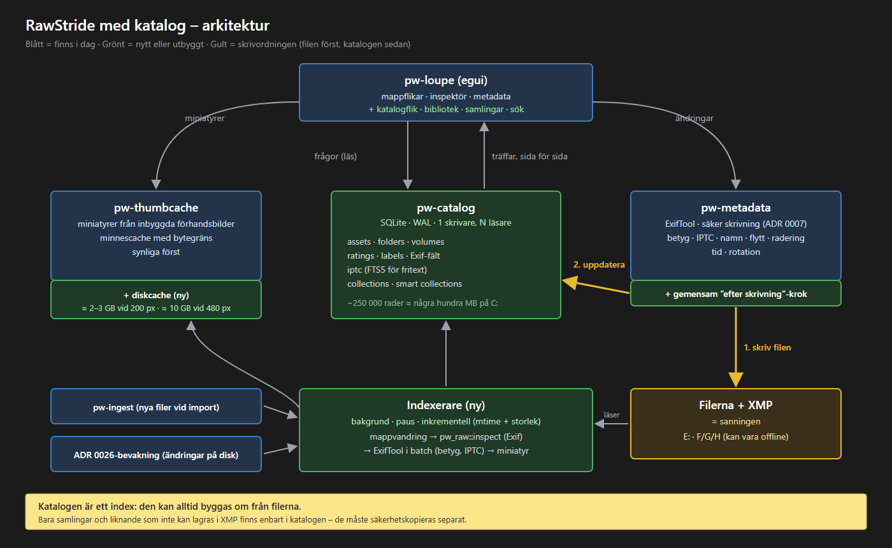
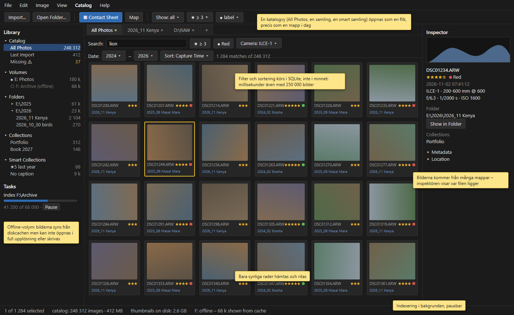

# ADR 0030: A catalog across folders, for searching the whole archive

- Status: **proposed (2026-11-19).** A draft for the owner. No question in §5 is answered,
  nothing is placed in the step plan, and nothing is built, installed or added as a dependency by
  this ADR. Step K0, the measurement on the owner's real archive, is done (2026-11-19, §6.1);
  when the questions are answered, each step in §6 becomes its own task, with its own approval
  and commit.
- Date: 2026-11-19
- Related:
  - [architecture.md](../architecture.md): goal 3 ("the SQLite catalog is an index and cache, not
    the only copy"), goal 4 (lightweight, no background services), the empty crate `pw-catalog`
    and the open question "Catalog per volume or global" (K-Q1);
  - ADR 0017 §2.1 and U4-Q7 (the library's sections Folders, Favourites, Recent), §7.2's row "A
    catalogue across folders (`pw-catalog`)", which this ADR takes up;
  - ADR 0022 (filter on text and metadata): the fields, the search box and the "Filter…" window,
    which a catalog tab reuses (§3.6);
  - ADR 0007 (metadata per IPTC): the files and their XMP remain the truth; §9 (the safe write),
    after which the catalog is updated (§3.4);
  - ADR 0013 (ratings and labels), ADR 0018 (deleting), ADR 0021 (renaming and moving): the writes
    whose results the catalog must follow;
  - ADR 0026 (a folder that follows changes on disk): the watcher of open folders, not of the
    catalog roots (§3.4);
  - ADR 0011 §11 and `pw-thumbcache`: thumbnails in memory only; a disk cache is K-Q8;
  - ADR 0029 (editor profiles): split from this ADR on the owner's decision (2026-11-19); a hit
    list is sent to the editing program with ADR 0019's "Open in {name}";
  - ADR 0010 and `pw-ingest` (import): an import into a catalog root adds its files (§3.4);
  - ADR 0028 (positions, parked): a search by place radius would come from there;
  - ADR 0002 (licence `GPL-3.0-or-later`): the new dependency (§3.2);
  - [clean-room.md](../clean-room.md): the functions are described from RawStride's own needs.

## 1. Context

- RawStride works on **one folder per tab**. Everything it knows about an image is read from the
  file and its sidecar when the folder is opened, or later on demand (ADR 0022 §2.4).
- The owner's archive is about **250,000 images** on several disks, with keywords kept up to date.
  Keywords are flat (no hierarchy), and the owner's rule is that every keyword is written in lower
  case.
- The owner wants to **search the whole archive** (for example every image with the keyword
  `fiskgjuse`, rated 3 or more, from one country), cull the hits with RawStride's usual keys, and
  send them to the editing program (ADR 0019, ADR 0029).
- Today that needs another program, or opening folder after folder.

## 2. The principle: an index, not the truth

The catalog is an **index** of what lies on disk:

- The files and their XMP are the only truth. Every rating, label and metadata change is written to
  the file first, as today (ADR 0007, ADR 0013); the catalog follows afterwards.
- A lost or damaged catalog is rebuilt from the files with no loss. It holds nothing that exists
  nowhere else, unless K-Q7 decides otherwise for collections.
- The folder tabs never depend on the catalog. A user who never turns it on never touches SQLite.

Sketch (an illustration made in the discussion of 2026-11-19, not a drawing of RawStride's code;
the notes are in Swedish; blue is what exists, green new or extended, yellow the order of a write:
the file first, then the catalog):

## 3. Decision (proposed)

### 3.1 One global catalog

One catalog file for the whole program (K-Q1), kept on the program's data drive (C: on the dev
machine, architecture.md). Disks are entries in a `volumes` table, so a disk that is not connected
is still searchable; its images are shown as offline (§3.7).

### 3.2 Storage

- SQLite through `rusqlite` with the bundled SQLite (a new dependency, about +1–1.5 MB in the
  program; the owner's approval and ADR 0002's licence check first). WAL, a single writer thread,
  readers as needed (architecture.md, `pw-catalog`).
- A capped page cache (16–64 MB). A hit list holds image ids only; the rows are fetched page by
  page as the contact sheet scrolls, so 100,000 hits cost little memory.
- Estimated size for 250,000 images: 0.3–0.5 GB (unmeasured; K0).

### 3.3 What is kept (schema sketch)

| Table | Content |
|---|---|
| `volumes` | id, label, the volume's serial or GUID, the drive letter last seen, last seen |
| `roots` | the catalog roots the owner chose: volume, path from the volume's root |
| `folders` | volume, path relative to the volume's root |
| `images` | folder, file name, size, mtime, file type, rating, label, reject, capture time, camera, lens, … |
| `keywords`, `image_keywords` | each keyword once, and the link to its images |
| `iptc` | Title, Headline, Description, Person Shown, Creator, City, Country, Location (Sublocation), … |
| `search` | an FTS5 table over keywords, place fields, Title, Headline and Description |

Indexes on rating, capture time and keyword. A query is an FTS5 match intersected with the index
conditions. The fields are those of ADR 0022 §2.1, so one filter model serves both a folder tab
and a catalog tab.

### 3.4 Indexing and keeping up to date

- **Catalog roots** are chosen by the owner in Settings (K-Q2). Backup disks are left out; nothing
  is indexed that the owner did not choose.
- **The first index** reads every image of the roots through the metadata worker, with at most 1–2
  ExifTool processes, at low priority, pausable, and only while RawStride runs (no background
  service, architecture.md goal 4). The Exif values are read with `pw-raw`'s own fast read where
  it covers them, the ratings, labels and IPTC values with ExifTool in batches (as ADR 0022 §2.4).
  Measured by K0 (§6.1): listing the roots takes about 80 s; reading every image with ExifTool
  about 4–5 hours with the two HDDs read at the same time, bound by the disks. The Tasks list
  shows the progress with a Pause button, the status line a short form.
- **An import** (`pw-ingest`, ADR 0010) into a catalog root adds its files to the catalog when
  they are verified; the latest import is the library's "Last Import".
- **An open folder** inside a catalog root that ADR 0026 F2–F3 follow: the changes the watcher
  sees are also handed to the catalog. The catalog roots themselves are not watched (K-Q13).
- **Keeping up to date:** at start, and on "Update Catalog", each root is listed with every file's
  size and mtime; a file whose size or mtime changed, or which is new, is read again; a file gone
  is marked missing. A folder's mtime is not enough, since a file rewritten in place does not change
  it. A **full re-read** is a separate command, for changes the listing cannot see (K-Q4).
- **RawStride's own writes** (ratings, labels, metadata, rename, move, delete) update the catalog
  through one shared hook after the safe write has answered, so the catalog never runs ahead of
  the file.
- **A drift check** compares the catalog with the files and reports the differences (a command,
  with a report; K-Q5).

### 3.5 Volumes

- A disk is recognised by its volume serial or GUID, at start and when a drive is connected; the
  drive letter is only remembered, never trusted.
- Known limits: formatting gives a new id; a cloned disk shares its id with the original; a network
  drive has none (K-Q3).
- Commands **"Locate Folder…"** (a folder moved within a volume) and **"This Volume Moved to…"**
  (a disk under a new id). A single file that has moved is only **suggested** (same name, size and
  capture time), never matched silently.
- FAT32 keeps mtime in local time to 2 seconds; the change check allows for it.

### 3.6 Searching

- A catalog search opens as a **tab**, like a folder, and the tab's contact sheet, preview, keys,
  rating, labels, marking and "Open in {name}" work as in a folder tab.
- The search box and the "Filter…" window of ADR 0022 are the same in a catalog tab; the values
  come from the catalog instead of being read per folder.
- Case-insensitive, including å, ä and ö: text is normalised in Rust before it is stored and
  searched (SQLite's `LOWER()` and `NOCASE` only know ASCII). No Swedish stemming: a prefix
  (`fiskgjus*`) finds the inflected forms.
- **Value lists with counts** (as ADR 0022 S-Q10) over the whole catalog, so spelling variants of a
  keyword or a city stand out. A list of keywords that break the owner's lower-case rule is a cheap
  check (K-Q6).
- A place may be an IPTC field or a keyword; the quick search covers both. Only keywords follow
  the lower-case rule; the IPTC place fields keep their case, and the search ignores it.
- Filter and sorting run in SQLite, not in memory, so they stay fast with 250,000 images.

### 3.7 The interface

- The library gets a section **Catalog** (K-Q9) with: All Photos, Last Import, Missing; the
  volumes, connected or not; the folders of the catalog roots; later Collections and Smart
  Collections (K-Q7).
- An offline image is marked in the contact sheet. Its thumbnail is shown only if a disk cache
  exists (K-Q8); "Open in {name}" and every write are refused with "Volume not connected".
- Each cell names the image's folder under the file name, since a hit list mixes folders; the
  inspector shows the folder, and "Show in File Explorer" (ADR 0019 §2.8) finds the file.
- A **Catalog** menu in the menu bar (K-Q9) holds Update Catalog, the full re-read, the drift
  check, Locate Folder… and This Volume Moved to….
- The status line shows indexing progress and the catalog's size; the Tasks list its errors.

Sketch (an illustration made in the discussion of 2026-11-19, not a screenshot of RawStride; the
notes are in Swedish; it shows the full picture, including the later collections, smart
collections and disk thumbnail cache of K-Q7 and K-Q8, which are not part of the first steps):

### 3.8 Keeping it light

- Nothing of the catalog is loaded at start until the Catalog section or a catalog tab is used.
- With the catalog turned off (the default until the owner turns it on), no SQLite file is
  created or opened, and V1–V8 are unchanged.

## 4. What this costs [estimate, 2026-11-19, unmeasured]

| Part | Tasks |
|---|---|
| K0 the measuring tool | 1–2 |
| Schema, migrations, the writer thread, queries | 4–6 |
| Volumes, roots, the first index, the change check, the full re-read | 5–8 |
| The shared after-write hook, the drift check | 2–4 |
| A catalog tab with ADR 0022's filter and search, value lists | 4–6 |
| The library's Catalog section, offline images, Locate and Moved commands | 3–5 |
| **Search-first total** | **≈ 20–30**, likely the upper end once special cases appear |
| Later: disk thumbnail cache, collections, smart collections, offline view | 15–30 more |

Sizes: the catalog 0.3–0.5 GB; a disk thumbnail cache (K-Q8) about 2.5 GB at 200 px and 10 GB at
480 px for 250,000 images.

## 5. Questions (open)

| # | Question | Proposal |
|---|---|---|
| K-Q1 | **One global catalog, or one per volume?** (architecture.md) | Global, with a `volumes` table: one search over every disk, offline disks still searchable |
| K-Q2 | How catalog roots are chosen, and are backup disks excluded? | Chosen in Settings, nothing by default; backup disks never offered automatically |
| K-Q3 | Volumes without a usable id (network drives, clones) | Not supported in the first steps; a clone is reported as a conflict, not merged |
| K-Q4 | The change check: size and mtime per file, plus a full re-read on demand. Is that enough, given that ExifTool's `-P` keeps the mtime of a file it writes? | Yes for RawStride's own writes (they update the catalog directly); for other programs that keep mtime, the full re-read. K0: a listing of all roots takes about 80 s. Since T204 RawStride's safe write no longer keeps the mtime (ADR 0007 §9.4); only the Tauri path's `-P` does |
| K-Q5 | The drift check: a command with a report, or automatic? | A command, with a report in the Tasks list |
| K-Q6 | Keywords breaking the lower-case rule: a report only, or also a warning or lower-casing in the metadata window? | A report in the catalog first; anything in the metadata window is a new feature for a later ADR. K0: no keyword with upper case in the sample |
| K-Q7 | Collections: kept in the catalog only (then the catalog must be backed up), or written to the files? A keyword such as `collections\|portfolio` breaks the flat-keyword rule | Not in the first steps; decided before collections are built |
| K-Q8 | A disk thumbnail cache: when, where (C: or D:), which size, with a size limit and "Empty Cache"? | Not in the first steps; decided after the search is in use |
| K-Q9 | Names in the library (Catalog, All Photos, Last Import, Missing, Volumes) | Proposed in each step, checked against the glossary |
| K-Q10 | Broader terms (a search for `rovfåglar` finding `fiskgjuse`): a synonym list in RawStride? | Later, in RawStride's settings, never written to the files |
| K-Q11 | The catalog off by default? | Yes: turned on by the owner in Settings |
| K-Q12 | Priority against the work under way (ADR 0019 E4, 0024 O1, 0027 W1–W9, 0029) | After them; K0 may be run earlier, as it touches nothing in the program |
| K-Q13 | Watch the catalog roots for changes while RawStride runs, beyond the open folders of ADR 0026? | No: the change check at start and on "Update Catalog" is enough. K0: the listing takes about 80 s for all roots, so a check at start is cheap |

## 6. Steps (proposed)

Each step ends with tests (GR11) and the owner's hand check.

| Step | Content | Needs |
|---|---|---|
| ~~**K0**~~ | **Done 2026-11-19 (§6.1):** the measurement on the owner's real archive, read-only: indexing time per disk, a size and mtime listing per disk, where keywords and place live and how many images have them, keywords breaking the lower-case rule. Run as scripts outside the repository (owner's choice, 2026-11-19), not as a tool under `tools/`; a sample first, then a full listing; no full ExifTool read (not needed before K1) | – |
| **K1** | `pw-catalog`: the schema, migrations, the writer thread, the FTS5 table, the text normalisation; tests on a small set | K0, `rusqlite` approved |
| **K2** | Volumes and roots: recognition by id, the roots in Settings, the catalog turned on and off | K1 |
| **K3** | The first index and the change check, at low priority and pausable; progress in the status line | K2 |
| **K4** | The shared after-write hook for RawStride's own writes | K3 |
| **K5** | A catalog tab with ADR 0022's search box and filter; value lists over the catalog | K3, ADR 0022 S1–S4 |
| **K6** | The library's Catalog section; offline images; Locate Folder and This Volume Moved | K5 |
| **K7** | The drift check and the keyword report | K4 |

Order: K0 first, then K1–K7. K5 waits for ADR 0022's filter, so the folder tab and the catalog tab
share one filter model.

### 6.1 K0: results (2026-11-19)

Read-only scripts (Python and ExifTool 13.59, outside the repository) on the owner's archive. The
owner named three archive disks, here disk 1–3: disk 1 an SSD (the catalog root is one folder of
it; the rest holds video and other files), disks 2 and 3 HDDs; no backup disks; a fourth disk left
out for now.

**The listing** (every file's size and mtime, `os.walk`, 2026-11-19):

| Root | Images | Of which | Sidecars (`.xmp`) | Size | Listing |
|---|---|---|---|---|---|
| Disk 1 (SSD, one folder) | 8,069 | 6,174 RAW (ARW), 1,895 DNG/JPEG/TIFF | 6,174 (and 609 `.dop`) | 0.36 TB | 0.6 s |
| Disk 2 (HDD) | 166,835 | 146,804 DNG, 7,313 JPEG, 5,280 TIFF, 6,042 CR2 | 7,679 | 3.6 TB | 43 s |
| Disk 3 (HDD) | 82,504 | 52,463 ARW, 11,539 CR2, 5,393 RAF, 2,478 ORF, 3,860 DNG | 76,437 | 3.4 TB | 36 s |
| **Total** | **≈ 257,000** | | ≈ 90,000 | ≈ 7.4 TB | ≈ 80 s |

Besides images the roots hold `.psd`, `.lrprev`, `.lua`, files without an extension and a few
others; the catalog ignores them.

**Reading the metadata** (a sample of one folder per disk: disk 2's year 2012, 7,853 images; disk
3's year 2020, 6,679 images and 4,971 sidecars; disk 1's October 2026, 352 images and sidecars):

- ExifTool, one process, cold disk cache: 10–22 files/s on the HDDs, 56 files/s on the SSD; with
  a warm cache 33–82 files/s, so the disks set the pace, not ExifTool.
- `-fast2` (600 files each from disk 2's year 2013 and disk 3's year 2021, half read each way, the
  values compared): the same values for every tag the catalog reads; about twice as fast on disk 3
  (RAW and sidecars, 16 → 30 files/s cold), hardly faster on disk 2's DNGs (10 → 11).
- A first full read therefore takes about 4–4.5 hours for disk 2 and 1.5 hours for disk 3, about 4–5
  hours with the two disks read at the same time (one ExifTool process per disk).
- **Keywords:** almost every image has them (7,853 of 7,853; 6,651 of 6,679; 349 of 352), always
  in XMP: embedded in DNG/JPEG/TIFF, in the sidecar for a RAW; none only in IIM, none only in the
  RAW's own XMP. 358, 405 and 6 distinct keywords.
- **Lower case:** no keyword with an upper-case letter in the sample.
- **`lr:hierarchicalSubject`:** in 3,775, 4,432 and 74 images, every entry flat (no `|`); ADR 0007
  §8's Q15 rule (T205) applies to all of them.
- **Place:** city or location in 0, 2,951 and 324 images; GPS in 200, 663 and 75; a title in
  2,864, 0 and 0.

What it changes: §3.4's estimate is replaced by the measured time; a first index is a matter of
hours and is pausable as proposed. K-Q4, K-Q6 and K-Q13 have a note from K0. The catalog size
(§4) is still an estimate.

## 7. Not included

- A catalog as the truth: nothing kept only in the catalog, except what K-Q7 may decide.
- Collections, smart collections, a disk thumbnail cache, offline viewing (K-Q7, K-Q8): later.
- A background service, or indexing while RawStride is closed.
- Hierarchical keywords.
- Search by place radius (ADR 0028).

## 8. Consequences

- **architecture.md:** "Catalog per volume or global" answered by K-Q1; `pw-catalog` gets content.
- **New dependency:** `rusqlite` with the bundled SQLite, approved by the owner and checked against
  ADR 0002.
- **ADR 0017:** the library gets the Catalog section; §7.2's catalog row points here.
- **ADR 0022:** its filter model is used by catalog tabs as well.
- **ADR 0007, 0013, 0018, 0021:** their writes call the shared after-write hook (K4).
- **ADR 0010 and ADR 0026:** an import and the watcher of open folders hand new and changed files
  to the catalog (§3.4).
- **Settings and glossary:** the catalog on or off, the roots, the new texts.
- With the catalog turned off nothing is loaded or opened, so V1–V8 are unchanged.
